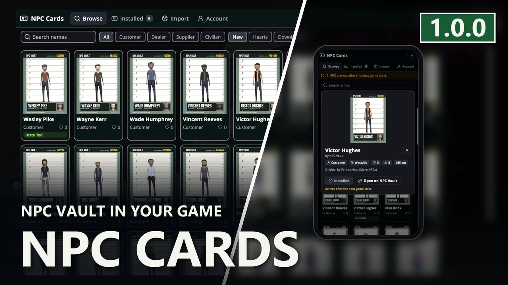
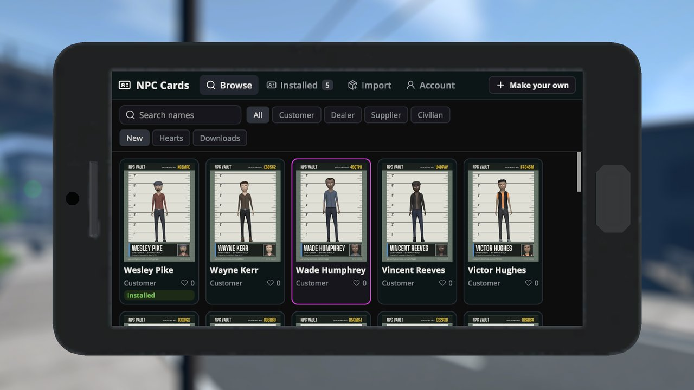
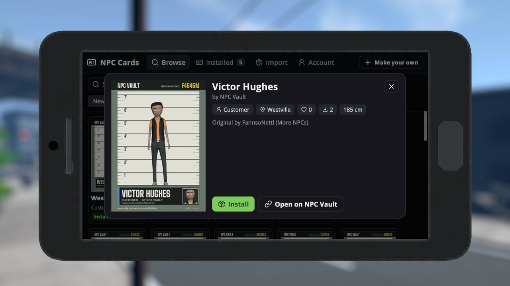
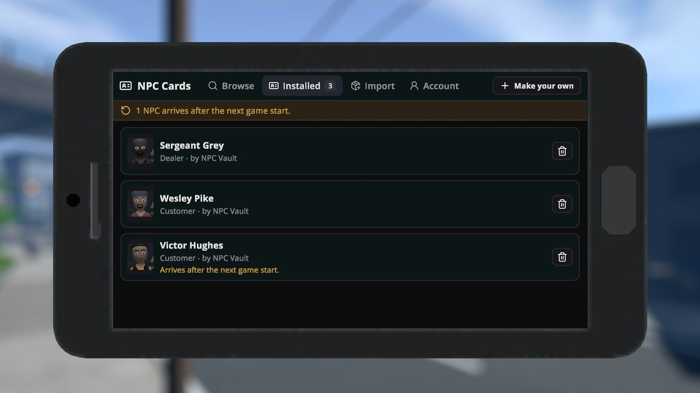
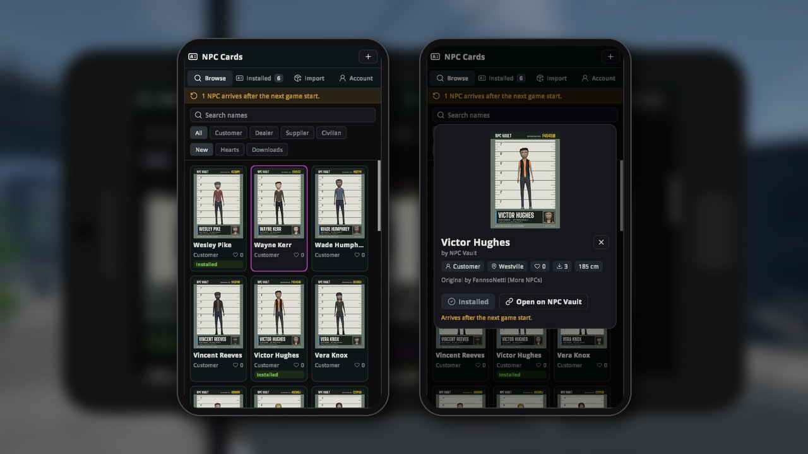
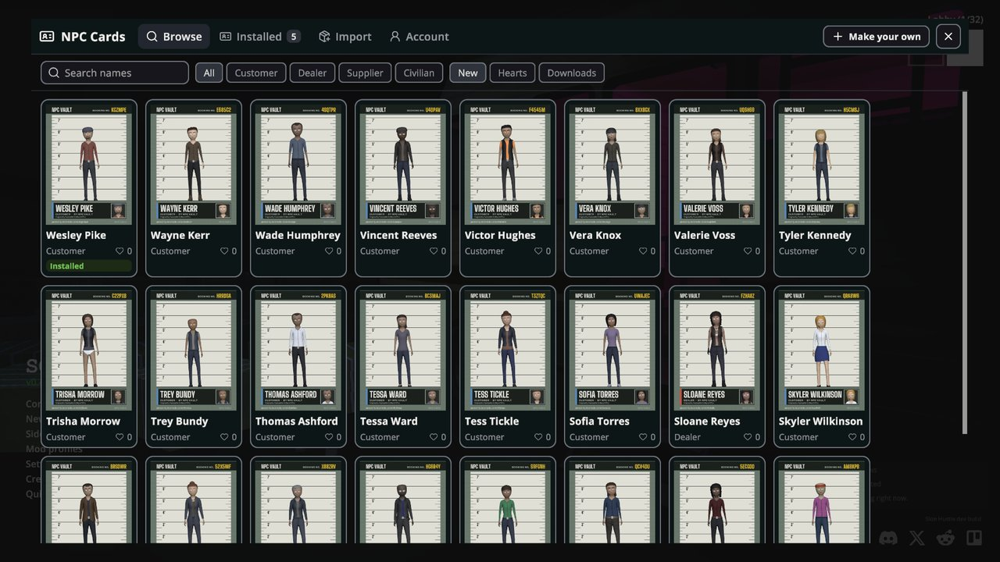

# NPC Cards - Add New NPCs in One Click for Schedule I

> 🛟 **Need help or found a bug?** Get support at [support.doodesch.de/npccards](https://support.doodesch.de/npccards).

**Download:** [Nexus Mods](https://www.nexusmods.com/schedule1/mods/3015) · [Thunderstore](https://thunderstore.io/c/schedule-i/p/DooDesch/NPC_Cards/) · [GitHub Releases](https://github.com/DooDesch-Mods/ScheduleOne-NpcCards/releases)

 

> Add new NPCs in one click. Browse the NPCs other players built on [NPC Vault](https://personify.doomods.com) and
> install them from your phone. Every card is a full NPC with
> look, schedule and role. Import downloaded card PNGs, send cards from the website to your game. Needs
> [Personnel](https://www.nexusmods.com/schedule1/mods/2275).

## What it does

| Tab | |
|---|---|
| **Browse** | Search NPC Vault, filter by role and region, sort by new, hearts or downloads. Each tile shows role, region and spending, cut or order limit. Open a card for its greeting and credit, then install it. |
| **Installed** | Every card Personnel has installed, also the ones from Personify or the import folder. Remove a card here. |
| **Import** | Card PNGs in `UserData/Personnel/Import/`. Install one now, or let Personnel install them at the next start. |
| **Account** | Connect the game to your NPC Vault account. Cards you send with "Send to game" on the website arrive here. Upload a card PNG from the import folder. |

A new NPC shows up after the next game start, not right away. The amber band says how many NPCs arrive or leave.

"Make your own" opens [Personify](https://www.nexusmods.com/schedule1/mods/2276), the editor that makes cards.

## Where it opens

- **Phone:** the NPC Cards app, in landscape and portrait.
- **Main menu:** with [Side Hustle](https://www.nexusmods.com/schedule1/mods/2232) installed, NPC Cards is
  also a menu gamemode. Escape or right-click steps back.

## Online

The mod talks to `personify.doomods.com` only:

- Browsing loads card lists and card pictures. No sign-in.
- Installing downloads the card PNG.
- Connecting links this game to your account with a code you confirm on the website. Personnel keeps the token in
  `UserData/Personnel/vault.json`. Disconnect removes it.
- Uploading sends the card PNG you pick.

## Screenshots

| | |
|---|---|
|  |  |
|  |  |
|  | |

## Installation

### Recommended: Nexus Mods

1. Install **MelonLoader 0.7.3** for Schedule I ([melonwiki.xyz](https://melonwiki.xyz/)).
2. Download NPC Cards from [Nexus Mods](https://www.nexusmods.com/schedule1/mods/3015) and install it with Vortex,
   or put **`NpcCards.dll`** into your Schedule I `Mods/` folder.
3. Get the mods under Requirements from their Nexus pages the same way.

### Thunderstore mod manager

Install from the [Thunderstore page](https://thunderstore.io/c/schedule-i/p/DooDesch/NPC_Cards/) with r2modman or Gale. The dependencies are pulled in automatically.

## Requirements

- MelonLoader 0.7.3+
- [Sideload](https://www.nexusmods.com/schedule1/mods/2360) 1.36.0+
- [Personnel](https://www.nexusmods.com/schedule1/mods/2275) 2.5.0+
- [S1API](https://thunderstore.io/c/schedule-i/p/ifBars/S1API_Forked/) (Personnel needs it to bring NPCs into the game)
- [Side Hustle](https://www.nexusmods.com/schedule1/mods/2232) (optional, for the menu gamemode)

## Languages

English and German. Your own translation goes to `UserData/DooDesch/Localization/NpcCards/<code>.json`; the
setting "Language" in the "DooDesch" preferences category picks the language.

## Community

Join the DooDesch Mods Discord: update pings, polls on what comes next, and playtests of new mods.

## License

Provided as-is under the [MIT License](LICENSE.md).

This mod is written with help from generative AI tools (Anthropic Claude, OpenAI Codex).
